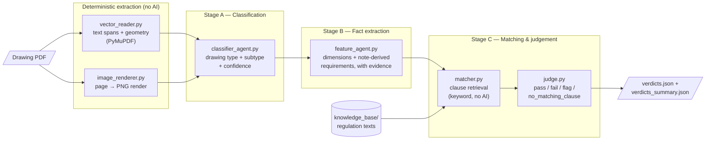
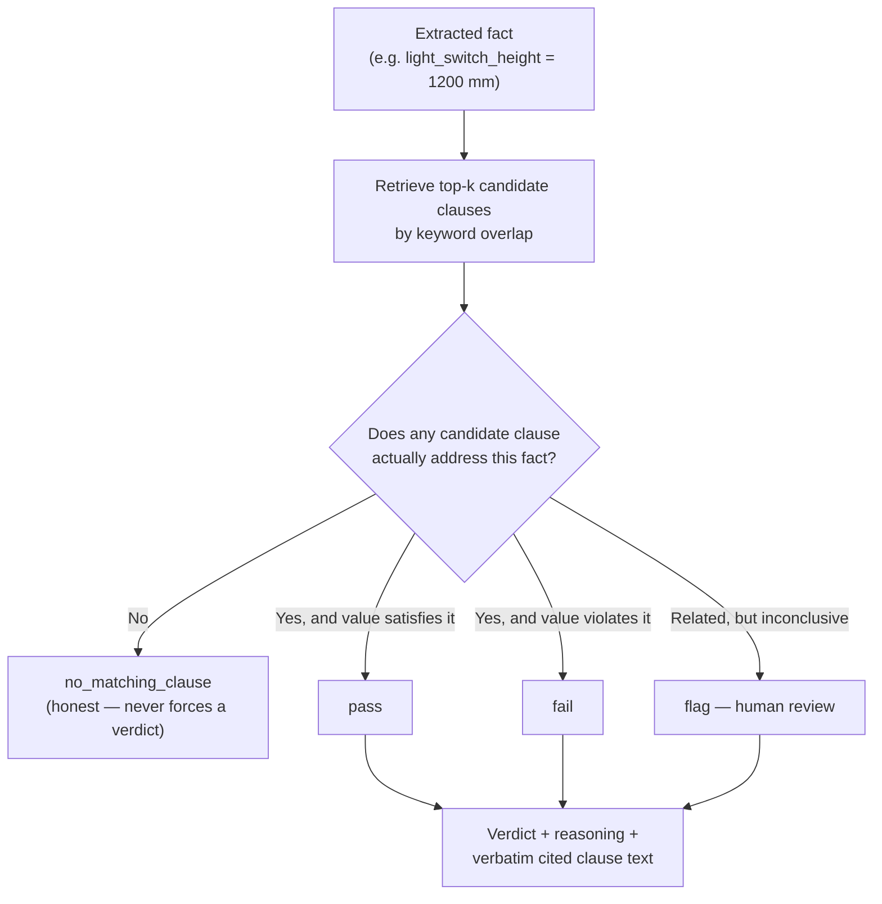

# Architectural Drawing Compliance Pipeline

An AI pipeline that reads CAD-exported architectural drawing PDFs and checks them against
UK (Northern Ireland) building regulations — producing **pass / fail / flag verdicts with the
exact regulation clause cited as evidence** for every finding.

A personal R&D project. Prototype status: working end-to-end on real drawing sets.

---

## What it does

Give it a drawing PDF (floor plan, electrical plan, elevation, …) and it will:

1. **Classify** every page by drawing type, fusing the PDF's vector text/geometry with a rendered image.
2. **Extract** every compliance-relevant fact on the page — labelled dimensions *and* requirements
   written in specification notes (U-values, material grades, mounting heights, named standards).
3. **Match** each fact against a knowledge base of building-regulation clauses and **judge** it:
   `pass`, `fail`, `flag` (needs human review), or `no_matching_clause` — never forcing a verdict
   onto an irrelevant clause.

Every verdict traces back to a verbatim quote on the drawing (with page coordinates) and a verbatim
excerpt from the regulation document, so a human reviewer can verify any finding in seconds.

### Example of a real catch

On a real electrical plan, the pipeline flagged:

> **FAIL — `kitchen_outlet_height` = 1100 mm**
> *"Paragraph 5.41 of Technical Booklet R: 2012 specifies that socket outlets should be located
> not more than 1000 mm above floor level, whereas the drawing specifies 1100 mm."*
> — with the full clause text from `TechnicalBookletR2012.pdf` attached as evidence.

---

## How it works



Each stage writes its results to disk and the next stage reads them back — so re-running Stage C
never re-pays for Stage A or B's API calls:

```mermaid
sequenceDiagram
    participant U as You
    participant A as Stage A<br/>classifier
    participant B as Stage B<br/>feature agent
    participant C as Stage C<br/>matcher + judge
    participant D as outputs/&lt;pdf&gt;/

    U->>A: run on drawing.pdf
    A->>D: page_NNN_vector.json, page_NNN.png, classification.json
    U->>B: run on drawing.pdf
    D->>B: reads Stage A artifacts
    B->>D: features.json
    U->>C: run on drawing.pdf
    D->>C: reads features.json
    C->>D: verdicts.json, verdicts_summary.json
```

### How a verdict is decided



---

## Design principles

- **Evidence-first.** Every fact carries its verbatim source quote and bounding box on the page;
  every verdict carries the verbatim clause text it relied on. Nothing is asserted without a citation.
- **Honest uncertainty.** Low-confidence classifications get a `needs_review` flag instead of passing
  silently downstream. The judge returns `no_matching_clause` rather than forcing a verdict from an
  irrelevant excerpt.
- **Cost-aware staging.** Stages persist their outputs and reuse upstream artifacts; retrieval
  (matcher) is deterministic keyword search — no API call where none is needed.
- **Drawings only.** Administrative documents (rejection letters, approval notices) are never processed
  by the pipeline — they are reserved as evaluation ground truth.

---

## Repository structure

```
data/                        # drawing PDFs (gitignored — not committed)
knowledge_base/
  regulations_combined.txt   # extracted regulation text (3 source documents)
knowledge_base_schema/
  clause_schema.json         # JSON Schema for structured clause records (not yet populated)
src/
  extraction/
    vector_reader.py         # PyMuPDF text + geometry extraction (no AI)
    image_renderer.py        # page-to-image rendering, incl. tiled high-DPI mode
  agents/
    classifier_agent.py      # Stage A — page classification
    feature_agent.py         # Stage B — fact extraction (two-pass: whole page + per note block)
    matcher.py               # Stage C part 1 — clause retrieval (keyword, no AI)
    judge.py                 # Stage C part 2 — compliance judgement
    vision_transcriber.py    # supplementary tiled-vision audit tool (expensive, optional)
  openrouter_client.py       # OpenRouter (OpenAI-compatible) API wrapper
  pipeline.py                # orchestrator (stub — stages currently run separately)
app.py                       # Flask demo web UI
templates/, static/          # demo UI assets
outputs/                     # per-PDF results, one folder per PDF (gitignored)
tests/
```

**Regulation source documents** (Northern Ireland Technical Booklets, included in repo root):
Technical Booklet R 2012 (access), Technical Booklet F1 2022 (conservation of fuel and power),
and Technical Booklet E (fire safety).

---

## Getting started

### Prerequisites

- Python 3.11+ (developed on 3.13)
- An [OpenRouter](https://openrouter.ai/) API key

### Setup

```bash
python -m venv .venv
.venv\Scripts\activate          # Windows  (source .venv/bin/activate on macOS/Linux)
pip install -r requirements.txt
copy .env.example .env          # then fill in OPENROUTER_API_KEY
```

Put one or more drawing PDFs in `data/` before running anything.

### Model

All AI stages use `google/gemini-3.1-flash-lite-20260507` via OpenRouter (configurable per stage —
every entry point takes a `model` argument).

---

## Usage

### Option 1 — Web UI (recommended for a demo)

```bash
python app.py
```

Open **http://127.0.0.1:5000/**, upload a PDF (or pick one already in `data/`), then run
Stage A → B → C from the dashboard. Verdicts display as a filterable table — click the
pass / fail / flag / no-match badges to filter.

### Option 2 — CLI, stage by stage

Run in order; each stage requires the previous stage's output for that PDF.

```bash
# Stage A — classify every page (~1 API call per page)
python -m src.agents.classifier_agent "data/your-drawing.pdf"

# Stage B — extract compliance-relevant facts
python -m src.agents.feature_agent "data/your-drawing.pdf"

# Stage C — match against regulations and judge
# (optional trailing number = judge only the first N facts, for a cheap test run)
python -m src.agents.judge "data/your-drawing.pdf" 5
```

### Outputs

All results land in `outputs/<pdf-name>/`:

| File | Stage | Contents |
|---|---|---|
| `page_NNN_vector.json` | A | raw extracted text spans + geometry per page |
| `page_NNN.png` | A | rendered page image |
| `classification.json` | A | drawing type, subtype, confidence, needs-review flag |
| `features.json` | B | every extracted fact with source quote + coordinates |
| `verdicts.json` | C | one verdict per fact with reasoning + cited clause |
| `verdicts_summary.json` | C | counts, plus failures and flags pulled out |

### Supplementary tools

```bash
# Tiled high-DPI vision transcription of one page — audit tool for unfamiliar
# drawing sets (~20 API calls per page vs ~1; not part of the default pipeline)
python -m src.agents.vision_transcriber "data/your-drawing.pdf" 0

# Inspect the regulation chunk corpus / test retrieval for one fact directly
python -m src.agents.matcher
```

---

## Current limitations & roadmap

| Area | Today | Planned |
|---|---|---|
| Clause retrieval | Keyword overlap over raw text chunks | Structured clause records (`clause_schema.json`) and/or embedding search — target: cut the `no_matching_clause` rate |
| Orchestration | Three separate stage commands | `pipeline.py` one-command run |
| Evaluation | Anecdotal (real catches on test drawings) | Systematic scoring against ground-truth building-control rejection/approval letters |
| Coverage | 3 NI Technical Booklets | Full Technical Booklet set; extendable to England/Wales Approved Documents |
| Tests | None yet | Unit tests for parsing, note-block detection, retrieval |

---

## Project context

A personal project exploring automated building-regulation compliance checking for architectural
drawings. The pipeline design (staged, evidence-cited, honest-uncertainty) is aimed at the workflow
of building control bodies and warranty providers, where every automated finding must be
independently verifiable by a human reviewer.
